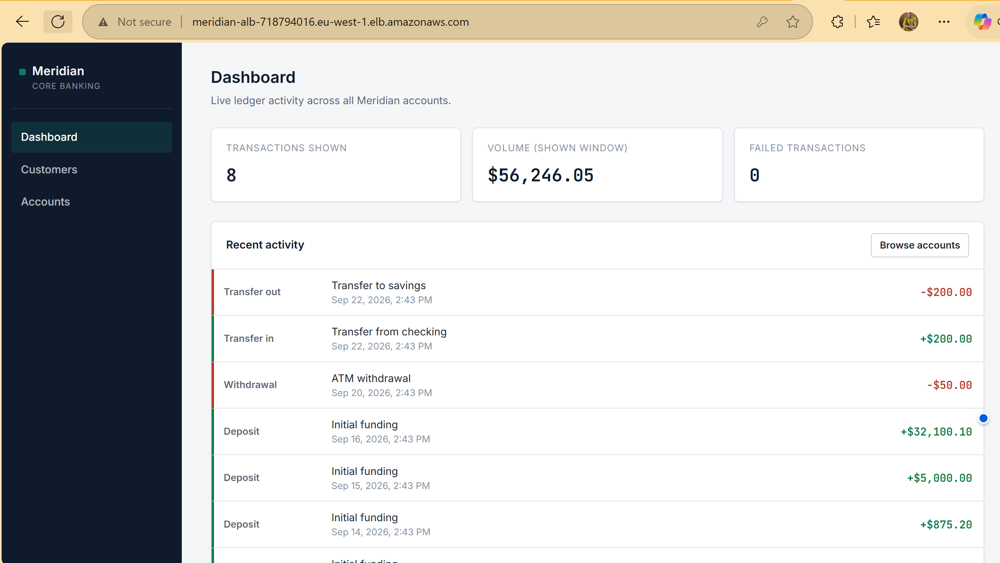
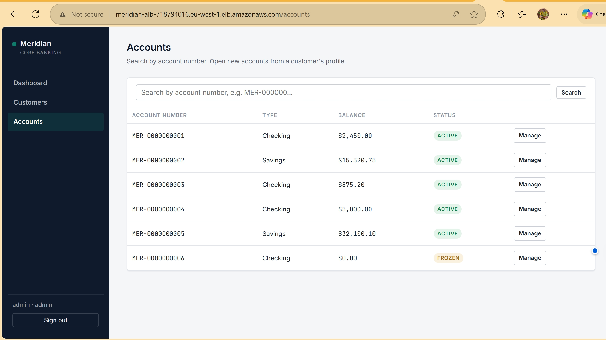
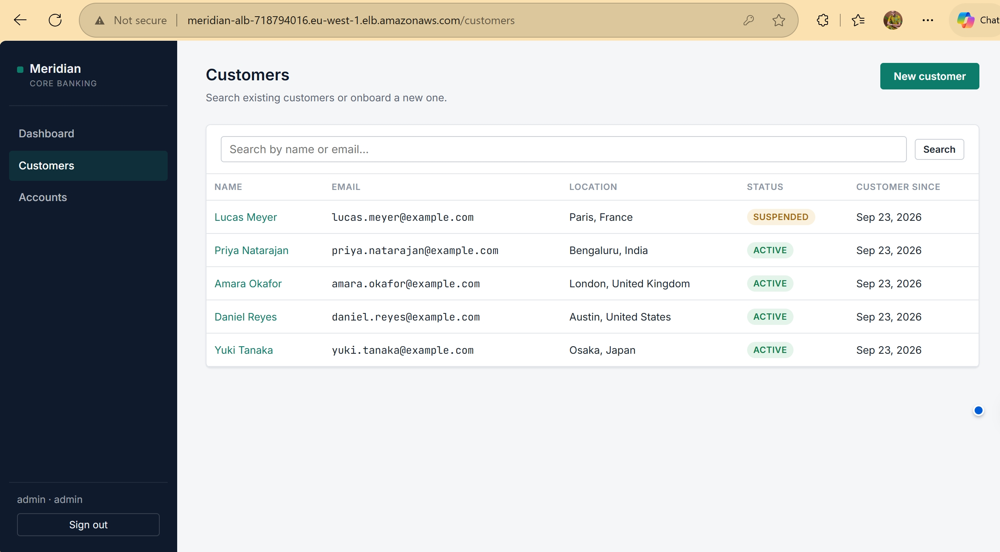

# Meridian Core Banking Platform

**A cloud-native core banking REST API and operations console, built to demonstrate production-grade Cloud/Platform/DevOps/SRE engineering practices — entirely within AWS Free Tier limits.**


> **No live demo URL.** The stack is deployed on demand and torn down after testing to avoid cost. All screenshots below were taken from a real deployment.

---

## Screenshots

### The application

| Dashboard | Account detail and ledger | Customer search |
|---|---|---|
|  |  |  |

### Running on AWS


*VPC resource map: public and private subnets, route tables, internet gateway.*


*Both ALB target groups reporting healthy ECS tasks.*

---

## What this is

Meridian is a fictional retail bank's core banking system: real customers,
real accounts, real deposits/withdrawals/transfers, backed by a real
PostgreSQL database with enforced constraints, row-level locking for
concurrency safety, and a full audit trail. It is a **portfolio project**,
but every write is a real write — nothing here is mocked.

It exists to demonstrate the skills expected of a **Cloud Engineer,
Platform Engineer, DevOps Engineer, SRE, or Cloud Infrastructure
Engineer**: schema design under real constraints, a production-shaped REST
API, containerization done correctly, and — the part most portfolio
projects skip — **AWS architecture reasoned about under a real cost
constraint**, not "how expensive can I make this look."

Full business scenario and architecture rationale: [`docs/01-project-overview.md`](docs/01-project-overview.md).

## Why the infrastructure looks the way it does

This isn't a 24/7 production service — it's built to be deployed, smoke
tested for a few minutes, and torn back down, without ever approaching a
meaningful AWS bill. That constraint shaped real architectural decisions
(ECS **Fargate** over EKS, **no NAT Gateway**, **Parameter Store** over
Secrets Manager) — each one explained, with the actual cost numbers, in
[`docs/02-infrastructure-guidance.md`](docs/02-infrastructure-guidance.md).

All infrastructure is written in Terraform and lives in [`infra/`](infra/);
the application code lives in `backend/` and `frontend/`.

<!--
OPTIONAL: if you screenshot AWS Cost Explorer for your test window, uncomment
this block and add the real figure.


*Cost of the full deploy, test and teardown cycle.*
-->

## Technology stack

| Layer | Choice | Why |
|---|---|---|
| Database | PostgreSQL 16 (Amazon RDS, Free Tier) | Native `NUMERIC`/`CHECK`/`JSONB` support; see [docs/01](docs/01-project-overview.md) |
| Backend | Node.js 20 + TypeScript + Express | Type-safe, widely used in cloud-native APIs, first-class AWS SDK support |
| Frontend | React 18 + TypeScript + Vite | Fast builds, small production bundle, industry-standard |
| Validation | Zod | Runtime + compile-time validation from one schema |
| Auth | JWT (bcrypt-hashed passwords) | Stateless, horizontally scalable across ECS tasks |
| Containers | Docker, multi-stage builds | Small, non-root, production-only images |
| Registry | Amazon ECR | Private images, scan on push, lifecycle policy to cap storage |
| Compute | ECS Fargate | No cluster control-plane fee, pay-per-second — see [docs/02](docs/02-infrastructure-guidance.md) |
| Load balancing | Application Load Balancer | Path-based routing between frontend and backend |
| Secrets | SSM Parameter Store (SecureString) | Free alternative to Secrets Manager for a short-lived stack |
| Monitoring | CloudWatch Logs, alarms, Container Insights + SNS | See [Monitoring overview](#monitoring-overview) |
| Testing | Jest, Supertest | See [docs/04-testing-guide.md](docs/04-testing-guide.md) |
| CI | GitHub Actions (strategy documented, not yet implemented) | See [docs/05-cicd-strategy.md](docs/05-cicd-strategy.md) |
| Infrastructure as Code | Terraform | AWS Free Tier–first, see [`infra/`](infra/) and [docs/02](docs/02-infrastructure-guidance.md) |

## Project structure

```
meridian-core-banking/
├── docs/                          Architecture, infra, testing, and CI/CD documentation
│   ├── 01-project-overview.md         Business scenario, architecture diagram, tech stack
│   ├── 02-infrastructure-guidance.md  AWS resource-by-resource rationale and cost breakdown
│   ├── 04-testing-guide.md            Test tiers, setup, how to run each
│   ├── 05-cicd-strategy.md            Pipeline stage design and reasoning
│   └── assets/                        Architecture diagram and screenshots
│
├── infra/                         AWS infrastructure as Terraform code
│   ├── *.tf                           VPC, RDS, ECS, ALB, ECR, IAM, CloudWatch, SNS, etc.
│   ├── terraform.tfvars.example       Template for your own AWS configuration
│   ├── outputs.tf                     Terraform outputs (e.g. ALB DNS name)
│   ├── README.md                      Deployment and operations guide
│   └── scripts/
│       └── run-migration.sh           One-off ECS task runner for database migrations
│
├── db/
│   ├── migrations/                001_create_schema.sql, 002_functions_and_triggers.sql
│   └── seeds/                     001_seed_data.sql — local/dev sample data only
│
├── backend/                       REST API (Node.js + TypeScript + Express)
│   ├── src/
│   │   ├── config/                 Validated, typed environment configuration
│   │   ├── db/                     PostgreSQL pool, transaction + row-locking helpers
│   │   ├── middleware/             Auth, validation, error handling, request logging
│   │   ├── modules/                One folder per domain: auth, customers, accounts, transactions, health
│   │   │   └── <module>/           routes → controller → service → repository, per module
│   │   ├── utils/                  AppError, structured logger, pure money math, account numbers
│   │   ├── app.ts                  Express app assembly (middleware stack, route mounting)
│   │   └── server.ts               Process entrypoint, graceful shutdown
│   ├── scripts/
│   │   ├── migrate.js                 Applies db/migrations in order, tracks applied migrations
│   │   └── seed.js                    Applies db/seeds (idempotent, runs every time)
│   ├── tests/
│   │   ├── unit/                    No database required
│   │   ├── integration/             Repository/service tests against a real Postgres
│   │   └── api/                     Full HTTP-layer tests via Supertest
│   ├── Dockerfile                  Multi-stage: compile TS → minimal production image
│   ├── Dockerfile.aws              AWS variant: builds from project root so db/ is included
│   └── package.json
│
├── frontend/                      Operations console (React + TypeScript + Vite)
│   ├── src/
│   │   ├── api/                     Typed fetch client + per-resource API functions
│   │   ├── components/              Layout, StatusBadge, Alert, RequireAuth route guard
│   │   ├── context/                 AuthContext (JWT storage, current user)
│   │   ├── pages/                   Login, Dashboard, Customers, CustomerDetail, Accounts, AccountDetail
│   │   ├── styles/                  Design tokens and base styles (single global.css)
│   │   └── utils/                   Money/date formatting helpers
│   ├── docker/nginx.conf           SPA-aware static file serving config
│   ├── Dockerfile                  Multi-stage: Vite build → nginx production image
│   └── package.json
│
├── docker-compose.yml              Wires db + migrate (one-off) + backend + frontend together
├── .env.example                    Variables docker-compose itself reads
├── .gitignore                      Excludes .env, node_modules, terraform.tfvars, state files, etc.
└── README.md                       This file
```

## Quick start (local, via Docker — no manual PostgreSQL install needed)

```bash
cp .env.example .env
# edit .env: set DB_PASSWORD, and a JWT_SECRET of at least 16 characters

docker compose up --build -d
docker compose run --rm migrate      # applies schema + seed data
```

Open:
- Console: **http://localhost:5173** — log in with `admin` / `ChangeMe123!`
- API health check: **http://localhost:4000/health/ready**

> The seed accounts (`admin`, `teller1`) share a known, dev-only password. That is fine for local use or a short-lived demo; change it before running anything longer-lived.

Tear down:
```bash
docker compose down       # stop, keep data
docker compose down -v    # stop and wipe the database volume
```

Dockerfile and compose design rationale lives inline as comments in
`docker-compose.yml`, `backend/Dockerfile`, and `frontend/Dockerfile`.

## AWS deployment

1. **Configure Terraform variables:**
   ```bash
   cd infra
   cp terraform.tfvars.example terraform.tfvars
   # edit terraform.tfvars with your AWS region, VPC CIDR, DB password, JWT secret
   ```

2. **Deploy infrastructure:**
   ```bash
   terraform init
   terraform plan
   terraform apply
   ```

3. **Build and push Docker images, then run migrations:**
   see [`infra/README.md`](infra/README.md) for the step-by-step commands.
   The frontend image bakes the API URL in at build time, so it must be
   built with the ALB's DNS name (from `terraform output`).

4. **Open the app** at the ALB's DNS name.

5. **Tear everything down** when you're done testing:
   ```bash
   terraform destroy
   ```


*Clean teardown: nothing is left running or billing after `terraform destroy`.*

**Key architectural decisions:**
- **Fargate, not EKS** — no Kubernetes control-plane fee, pay-per-second billing, nothing left running by accident.
- **No NAT Gateway** — saves roughly $30+/month. ECS tasks run in public subnets, isolated by security groups (internet → ALB → tasks → database, each tier only accepting traffic from the one before it). RDS sits in private subnets with no internet route.
- **Migrations via ECS** — because RDS is unreachable from outside the VPC, `bash infra/scripts/run-migration.sh` launches a one-off Fargate task to apply the schema and seeds, instead of a bastion host.
- **One ALB, path-based routing** — `/api/*` goes to the backend target group; everything else goes to the frontend. HTTP only (no custom domain or certificate), which is appropriate for a short-lived demo.
- **Two ECS services** — frontend (nginx) and backend (Express) run separately, mirroring `docker-compose.yml`.
- Full cost breakdown and rationale: [`docs/02-infrastructure-guidance.md`](docs/02-infrastructure-guidance.md)

## Testing

```bash
cd backend
npm run test:unit          # no database needed
npm run test:integration   # needs a real Postgres — see docs/04-testing-guide.md
npm run test:api           # full HTTP-layer tests, needs a real Postgres
npm test                   # all three tiers
npm run test:coverage
```

The full suite (unit + integration + API) runs against a real PostgreSQL
instance — **65/65 passing**, including a concurrency test that fires two
simultaneous withdrawals at the same account and proves the database's
row-level locking allows exactly one to succeed. Details and rationale:
[`docs/04-testing-guide.md`](docs/04-testing-guide.md).


## Monitoring overview

Observability is built into both the application and the infrastructure (`infra/`):

- **Structured logging:** the API writes JSON logs (Pino), which ECS ships to CloudWatch Logs (`/ecs/meridian/backend`, `/ecs/meridian/frontend`), so fields like `code` and `requestId` are queryable.
- **Health checks:** `/health/live` and `/health/ready` back the ALB target group checks. The frontend uses `/nginx-health`.
- **CloudWatch alarms**, all notifying an SNS email topic: backend 5xx errors, backend CPU, backend memory, RDS connection count, and failed transactions (a custom metric derived from `INSUFFICIENT_FUNDS` log lines using a log metric filter).
- **ECS Container Insights** is enabled on the cluster for container-level metrics.


*All alarms evaluating and in the OK state.*


*Structured backend logs in CloudWatch Logs.*


*The custom failed-transactions metric, fed by deliberate insufficient-funds attempts.*

## Security notes

- Every SQL query in the backend is parameterized — no string-concatenated
  SQL anywhere (`backend/src/db/pool.ts`).
- Passwords are bcrypt-hashed; national ID numbers are HMAC-hashed, never
  stored in plaintext (`backend/src/modules/customers/customers.service.ts`).
- Least-privilege, role-based API access (`ADMIN` / `TELLER` / `VIEWER`)
  enforced via middleware, verified in `backend/tests/api/customers.api.test.ts`.
- Secrets (DB password, JWT secret) are stored as SSM Parameter Store
  SecureStrings and injected into the container at startup — never
  committed, never baked into an image; see `.gitignore` and every
  `.env.example` in this repo.
- Network isolation: security groups chain internet → ALB → ECS tasks → RDS,
  and RDS is not publicly accessible.
- IAM: separate ECS task execution and task roles. The execution role has
  only the AWS-managed ECR/Logs policy plus read access scoped to the
  `/meridian/*` parameter path; the task role has no permissions.
- ECR: scan on push, immutable tags (except `latest*`), and a lifecycle
  policy keeping only recent images.
- Terraform state is local and gitignored because it contains secret values.
  A remote, encrypted backend would be the production approach.
- Full AWS-side reasoning:
  [`docs/02-infrastructure-guidance.md`](docs/02-infrastructure-guidance.md).

## Future improvements

- HTTPS with an ACM certificate and a custom domain (the ALB security group already allows 443).
- Move ECS tasks into private subnets behind VPC endpoints, as a production-style posture.
- Remote Terraform state (S3 with encryption and locking).
- A CloudWatch dashboard consolidating the key metrics above.
- GitHub Actions workflows implementing the stages designed in
  [`docs/05-cicd-strategy.md`](docs/05-cicd-strategy.md).
- Multi-AZ RDS and ECS auto scaling for a persistent deployment.
- Multi-currency support with real exchange-rate conversion (currently
  single-currency-per-account only).
- Scheduled/recurring transfers.
- Overdraft products with an explicit credit-limit column, rather than the
  current hard `balance >= 0` constraint.
- Rate-limit tuning per role (e.g. stricter limits for unauthenticated
  `/api/auth/login` attempts, to slow credential stuffing).

## License

Released under the MIT License. See [`LICENSE`](LICENSE).
