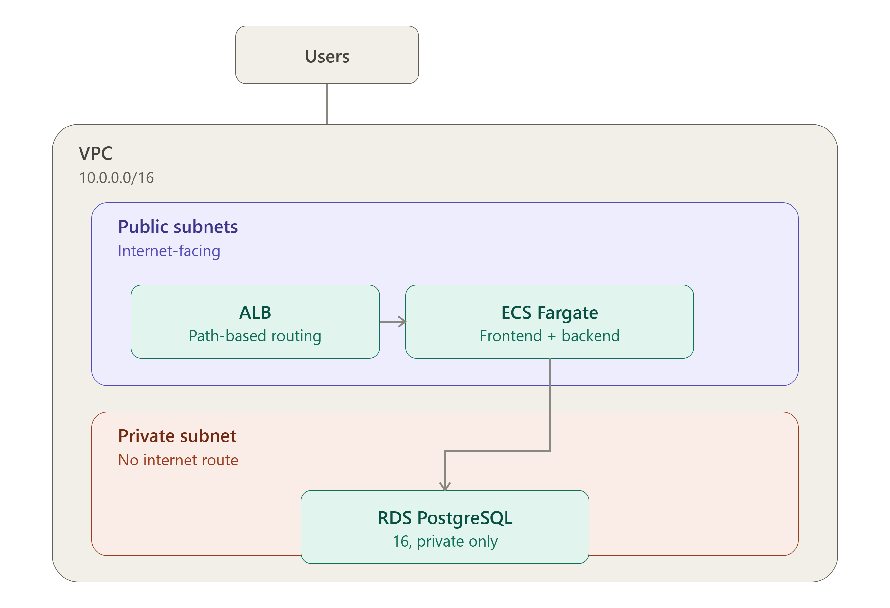

# Meridian Core Banking Platform

**A cloud-native core banking REST API and operations console, built to demonstrate production-grade Cloud/Platform/DevOps/SRE engineering practices — entirely within AWS Free Tier limits.**

>.

> 📸 **Screenshots placeholder** — add screenshots of the console (dashboard, customer search, account detail with the transaction ledger) to `docs/assets/` once deployed, e.g. `docs/assets/screenshot-dashboard.png`.

---

## What this is

Meridian is a fictional retail bank's core banking system: real customers,
real accounts, real deposits/withdrawals/transfers, backed by a real
PostgreSQL database with enforced constraints, row-level locking for
concurrency safety, and a full audit trail. It is a **portfolio project**,
but every write is a real write — nothing here is mocked.

It exists to demonstrate the skills expected of a **Cloud Engineer,
Platform Engineer, DevOps Engineer, SRE, or Cloud Infrastructure
Engineer**: schema design under real constraints, a production-shaped REST
API, containerization done correctly, and — the part most portfolio
projects skip — **AWS architecture reasoned about under a real cost
constraint**, not "how expensive can I make this look."

Full business scenario and architecture rationale: [`docs/01-project-overview.md`](docs/01-project-overview.md).

## Why the infrastructure looks the way it does

This isn't a 24/7 production service — it's built to be deployed, smoke
tested for a few minutes, and torn back down, without ever approaching a
meaningful AWS bill. That constraint shaped real architectural decisions
(ECS **Fargate** over EKS, **no NAT Gateway**, **Parameter Store** over
Secrets Manager) — each one explained, with the actual cost numbers, in
[`docs/02-infrastructure-guidance.md`](docs/02-infrastructure-guidance.md).
All Terraform for the infrastructure described there is in the `infra/`
directory — the application code lives here, infrastructure lives there.

## Technology stack

| Layer | Choice | Why |
|---|---|---|
| Database | PostgreSQL 16 (Amazon RDS, Free Tier) | Native `NUMERIC`/`CHECK`/`JSONB` support; see [docs/01](docs/01-project-overview.md) |
| Backend | Node.js 20 + TypeScript + Express | Type-safe, widely used in cloud-native APIs, first-class AWS SDK support |
| Frontend | React 18 + TypeScript + Vite | Fast builds, small production bundle, industry-standard |
| Validation | Zod | Runtime + compile-time validation from one schema |
| Auth | JWT (bcrypt-hashed passwords) | Stateless, horizontally scalable across ECS tasks |
| Containers | Docker, multi-stage builds | Small, non-root, production-only images |
| Testing | Jest, Supertest | See [docs/04-testing-guide.md](docs/04-testing-guide.md) |
| Compute | ECS Fargate | No cluster control-plane fee, pay-per-second — see [docs/02](docs/02-infrastructure-guidance.md) |
| CI | GitHub Actions (strategy documented, not yet generated) | See [docs/05-cicd-strategy.md](docs/05-cicd-strategy.md) |
| Infrastructure as Code | Terraform | AWS Free Tier–first, see [`infra/`](infra/) and [docs/02](docs/02-infrastructure-guidance.md) |

## Project structure

```
meridian-core-banking/
├── docs/                          Architecture, infra, testing, and CI/CD documentation
│   ├── 01-project-overview.md         Business scenario, architecture diagram, tech stack
│   ├── 02-infrastructure-guidance.md  AWS resource-by-resource rationale and cost breakdown
│   ├── 04-testing-guide.md            Test tiers, setup, how to run each
│   └── 05-cicd-strategy.md            Pipeline stage design and reasoning
│
├── infra/                         AWS infrastructure as Terraform code (separate from app)
│   ├── *.tf                           VPC, RDS, ECS, ALB, IAM, security groups, etc.
│   ├── terraform.tfvars               Your AWS configuration (DO NOT commit)
│   ├── outputs.tf                     Terraform outputs for CI/CD integration
│   ├── README.md                      Deployment and operations guide
│   └── scripts/
│       └── run-migration.sh           One-off ECS task runner for database migrations
│
├── db/
│   ├── migrations/                001_create_schema.sql, 002_functions_and_triggers.sql
│   └── seeds/                     001_seed_data.sql — local/dev sample data only
│
├── backend/                       REST API (Node.js + TypeScript + Express)
│   ├── src/
│   │   ├── config/                 Validated, typed environment configuration
│   │   ├── db/                     PostgreSQL pool, transaction + row-locking helpers
│   │   ├── middleware/             Auth, validation, error handling, request logging
│   │   ├── modules/                One folder per domain: auth, customers, accounts, transactions, health
│   │   │   └── <module>/           routes → controller → service → repository, per module
│   │   ├── utils/                  AppError, structured logger, pure money math, account numbers
│   │   ├── app.ts                  Express app assembly (middleware stack, route mounting)
│   │   └── server.ts               Process entrypoint, graceful shutdown
│   ├── scripts/
│   │   ├── migrate.js                 Applies db/migrations in order, tracks applied migrations
│   │   └── seed.js                    Applies db/seeds (idempotent, runs every time)
│   ├── tests/
│   │   ├── unit/                    No database required
│   │   ├── integration/             Repository/service tests against a real Postgres
│   │   └── api/                     Full HTTP-layer tests via Supertest
│   ├── Dockerfile                  Multi-stage: compile TS → minimal production image
│   ├── Dockerfile.aws              AWS variant: builds from project root, includes db/ folder
│   └── package.json
│
├── frontend/                      Operations console (React + TypeScript + Vite)
│   ├── src/
│   │   ├── api/                     Typed fetch client + per-resource API functions
│   │   ├── components/              Layout, StatusBadge, Alert, RequireAuth route guard
│   │   ├── context/                 AuthContext (JWT storage, current user)
│   │   ├── pages/                   Login, Dashboard, Customers, CustomerDetail, Accounts, AccountDetail
│   │   ├── styles/                  Design tokens and base styles (single global.css)
│   │   └── utils/                   Money/date formatting helpers
│   ├── docker/nginx.conf           SPA-aware static file serving config
│   ├── Dockerfile                  Multi-stage: Vite build → nginx production image
│   └── package.json
│
├── docker-compose.yml              Wires db + migrate (one-off) + backend + frontend together
├── .env.example                    Variables docker-compose itself reads
├── .gitignore                      Excludes .env, node_modules, terraform.tfvars, etc.
└── README.md                       This file
```

## Quick start (local, via Docker — no manual PostgreSQL install needed)

```bash
cp .env.example .env
# edit .env and set a real JWT_SECRET

docker compose up --build -d
docker compose run --rm migrate      # applies schema + seed data
```

Open:
- Console: **http://localhost:5173** — log in with `admin` / `ChangeMe123!`
- API health check: **http://localhost:4000/health/ready**

Tear down:
```bash
docker compose down       # stop, keep data
docker compose down -v    # stop and wipe the database volume
```

Full local development and Docker workflow: this README's Quick Start
above covers the common path; Dockerfile/compose design rationale lives
inline as comments in `docker-compose.yml`, `backend/Dockerfile`, and
`frontend/Dockerfile`.

## AWS Deployment

To deploy to AWS using Terraform and ECS:

1. **Configure Terraform variables:**
   ```bash
   cd infra
   cp terraform.tfvars.example terraform.tfvars
   # edit terraform.tfvars with your AWS region, VPC CIDR, DB password, JWT secret
   ```

2. **Deploy infrastructure:**
   ```bash
   terraform init
   terraform plan
   terraform apply
   ```

3. **Build and push Docker images, then run migrations:**
   See [`infra/README.md`](infra/README.md) for full step-by-step instructions.

**Key architectural decisions:**
- **RDS in private subnet** — secure (not internet-facing), cheaper (no NAT Gateway), requires one-off Fargate task for migrations
- **Migrations via ECS** — `bash infra/scripts/run-migration.sh` launches a temporary task to apply schema and seeds
- **Fargate (not EKS)** — no Kubernetes control-plane fee, pay-per-second, good for small deployments
- **No NAT Gateway** — saves ~$30/month, acceptable for a demo project
- Full cost breakdown and rationale: [`docs/02-infrastructure-guidance.md`](docs/02-infrastructure-guidance.md)

## Testing

```bash
cd backend
npm run test:unit          # no database needed
npm run test:integration   # needs a real Postgres — see docs/04-testing-guide.md
npm run test:api           # full HTTP-layer tests, needs a real Postgres
npm test                   # all three tiers
npm run test:coverage
```

The full suite (unit + integration + API) has been run against a real
PostgreSQL instance during development — **65/65 passing**, including a
concurrency test that fires two simultaneous withdrawals at the same
account and proves the database's row-level locking allows exactly one to
succeed. Details and rationale: [`docs/04-testing-guide.md`](docs/04-testing-guide.md).

## Monitoring overview

Monitoring is one of this project's primary objectives, implemented at
the infrastructure layer (owned in [`infra/`](infra/)) rather
than in application code beyond structured logging and the `/health/live`
and `/health/ready` endpoints this API exposes for the ALB and container
health checks to use. Planned CloudWatch dashboards cover CPU/memory,
request count and latency, HTTP status code breakdown, database
connections, and transaction volume/failure rate — full design and the
SRE-incident-response rationale for each is in
[`docs/02-infrastructure-guidance.md`](docs/02-infrastructure-guidance.md).
*(Dashboard screenshots to be added here once the Terraform is applied and
the stack has real traffic to show.)*

## Security notes

- Every SQL query in the backend is parameterized — no string-concatenated
  SQL anywhere (`backend/src/db/pool.ts`).
- Passwords are bcrypt-hashed; national ID numbers are HMAC-hashed, never
  stored in plaintext (`backend/src/modules/customers/customers.service.ts`).
- Least-privilege, role-based API access (`ADMIN` / `TELLER` / `VIEWER`)
  enforced via middleware, verified in `backend/tests/api/customers.api.test.ts`.
- Secrets (DB credentials, JWT secret) are injected via environment
  variables / SSM Parameter Store in AWS — never committed; see `.gitignore`
  and every `.env.example` in this repo.
- Full AWS-side IAM/Security Group/Secrets reasoning:
  [`docs/02-infrastructure-guidance.md`](docs/02-infrastructure-guidance.md).

## Future improvements

- Multi-currency support with real exchange-rate conversion (currently
  single-currency-per-account only).
- Scheduled/recurring transfers.
- Overdraft products with an explicit credit-limit column, rather than the
  current hard `balance >= 0` constraint.
- Rate-limit tuning per role (e.g. stricter limits for unauthenticated
  `/api/auth/login` attempts specifically, to slow credential stuffing).
- Actual GitHub Actions workflow files implementing the stages designed in
  [`docs/05-cicd-strategy.md`](docs/05-cicd-strategy.md).
- CloudWatch dashboards and alarms, once the Terraform infrastructure in
  `docs/02-infrastructure-guidance.md` is applied.

## License

Portfolio project — no license currently applied. Add one here (MIT is a
common default for portfolio work) if you intend to make this repository
public.
